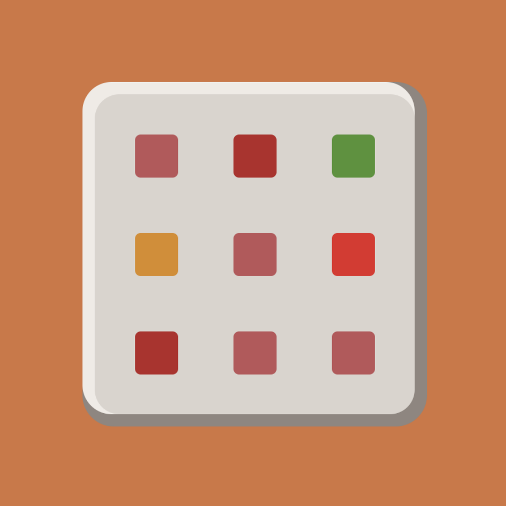
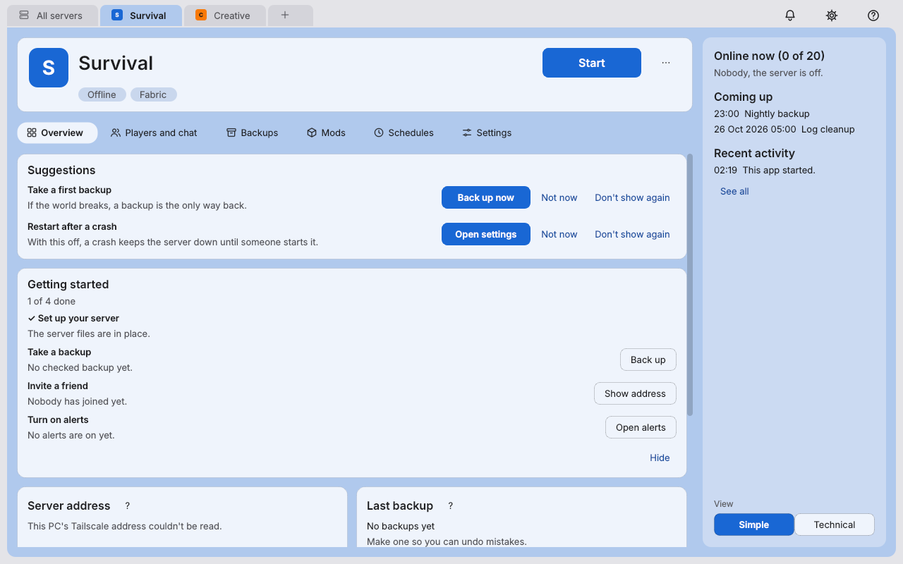

  
  <h2 align="center">Command Block</h2>
  
Create and manage Minecraft servers easily.

  <a href="https://github.com/peyoteheadlights/command-block/releases">Releases</a>
  ·
  <a href="https://github.com/peyoteheadlights/command-block/issues/new?template=bug_report.yml">Report a bug</a>
  ·
  <a href="https://github.com/peyoteheadlights/command-block/issues/new?template=feature_request.yml">Ask for a feature</a>

  

## What is this and why would I use it?

As a kid I remember how rough it was not being able to figure out how to play Minecraft with my friends. Command Block lets you create and manage servers easily without complication, simplifying everything into one app that you set up on your server PC, then manage from your phone or laptop (and soon from Discord too). It's built with simplicity in mind to accommodate any tech level and offers suggestions on troubleshooting and how to keep the server running at its best, with a "Technical" mode that offers more advanced features for the tech-savvy people out there who want a clean way to manage multiple big and complicated servers all from one place, for free!

## What servers does it work with?

- Vanilla
- Fabric
- Quilt
- Forge
- NeoForge
- Paper
- Purpur
- Bedrock

You can use a server you already have, or let the setup make a new one.

## How do I get it?

You need a Windows 10 or 11 PC, and [Tailscale](https://tailscale.com) (free) on that PC and on each phone or laptop you want to use.

1. Download `CommandBlock-Setup-<version>.exe` from the [latest release](https://github.com/peyoteheadlights/command-block/releases/latest).
2. Run it and follow the setup.
3. Select **Open Command Block** on the last screen (or open it from the Start menu), and scan **Open on your phone** with your phone.

Windows may say "Unknown publisher" because the setup file isn't signed yet (I'm working on it, promise). [docs/installation.md](docs/installation.md#windows-protected-your-pc--unknown-publisher) shows how to check the file.

## Please note

This is a student project I've been working on as a hobby for my personal use, and my friends suggested I release it. The app is a work in progress and may have a few bugs. If you run into any, please let me know by [reporting a bug](https://github.com/peyoteheadlights/command-block/issues/new?template=bug_report.yml).

## Planned features

This app is in no way done and will be supported for a good long while. Here's everything that's planned, roughly in order (no dates, it's a hobby project):

**Discord bot** (a lot is in already: setup, Discord role permissions, status and alerts, starting, account linking, the chat bridge, /stats, Levels with Level roles, a weekly leaderboard and quests with rewards, see [docs/discord.md](docs/discord.md))

- Events with RSVPs and reminders, simple polls, and `/report` for reporting a player to the owners.
- Whitelist from Discord: `/whitelist add`, or an application form owners approve with a button.
- Kick, ban, backup and restart buttons on alerts, and a read-only console channel (off by default).
- `/store` to show the server's store, and store ranks that become Discord roles.

**Bigger servers and safety**

- Safety notes and saved version lists that stay up to date without a new release.
- Manage servers on several PCs under one owner account.
- Help picking a server type, support for Spigot, Leaf and custom jars, and switching a server's type (for example Vanilla to Paper).
- Add mods from a link or file, including CurseForge, plus recommended add-ons, performance and QoL suggestions, and guides for popular add-ons.
- Editing add-on config files inside the app.
- Bring a server in from a folder or zip, or bring servers back from a backup folder on a new PC.
- Test servers, and "New season" (keep the old world, start a fresh one with the same settings).
- A server store through Tebex, cosmetics only by default.
- Attack protection, a changeable port, and sign-in for offline-mode servers.
- Start a sleeping server when someone tries to join, a "new version is out" alert, a player activity graph and your own command buttons.
- Controlling servers on rented hosts that have an official API.
- playit.gg support.

**Getting it ready for 1.0**

- Cleaner, smaller code and a simpler README.
- Testing the whole app as a first-time player, a guided phone setup, a Tailscale share for moderators and a "First run and friends joining" guide.
- A security check of the whole project, the phone apps in the App Store and Google Play, and a signed setup file.

**After 1.0**

- Your own server store run inside Command Block (no Tebex needed).
- Server networks (a lobby plus other servers, with Velocity or BungeeCord).
- Folia and Minecraft Education servers.
- Running the server side on Linux, Raspberry Pi and Mac.
- Translations.
- A Mac desktop app (maybe).

Got more ideas? Make a [feature request](https://github.com/peyoteheadlights/command-block/issues/new?template=feature_request.yml).

## Support the project

Command Block is free and stays free. Donating unlocks nothing, everyone gets every feature either way. If it helps you and you want to support it:

- [GitHub Sponsors](https://github.com/sponsors/peyoteheadlights)
- [Ko-fi](https://ko-fi.com/peyoteheadlights)

## More

- [docs/troubleshooting.md](docs/troubleshooting.md) for common problems.
- [docs/developers.md](docs/developers.md) for how it's built and how to run it from source.
- [SECURITY.md](SECURITY.md) to report a security problem privately.

## License

[MIT License](LICENSE), Copyright (c) 2026 peyoteheadlights. The setup and the program use Qt for Python (PySide6) under the LGPLv3, see [THIRD-PARTY-NOTICES.md](THIRD-PARTY-NOTICES.md).

NOT AN OFFICIAL MINECRAFT PRODUCT. NOT APPROVED BY OR ASSOCIATED WITH MOJANG OR MICROSOFT.
